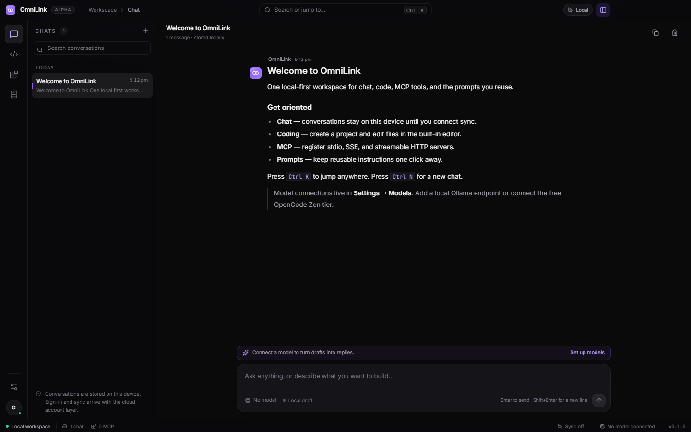

# OmniLink Desktop

A local-first desktop workspace for conversations, agentic coding, MCP tools, and
the prompts you reuse. Built with a Tauri 2 / Rust shell and a React 19 frontend.



## Status

OmniLink Desktop is a **v0.1.0 prototype**. The shell, navigation, workspace data,
editor, and settings are functional. The model runtime, native storage, account
sync, MCP process supervision, and updater feed are scaffolded in the UI but not
connected yet.

### Working today

- **Chat workspace** — conversations, search, drafts, markdown rendering, and
  local persistence via `localStorage`.
- **Coding workspace** — projects, file tree, tabs, lazy-loaded Monaco editor,
  unsaved-change guards, and a side-by-side diff preview.
- **MCP registry** — add, edit, enable/disable, and inspect stdio, SSE, and
  streamable HTTP server definitions.
- **Prompt library** — create, edit, search, favorite, and reuse prompts.
- **Settings** — dark / light / system themes, five accent presets, reduced
  motion, OpenCode detection (native build), Ollama endpoint checks, JSON export,
  workspace reset, guest account state, updates, and about.
- **Shell** — frameless custom titlebar, native window controls, Mica backdrop on
  Windows 11, icon rail, contextual panes, command palette, toasts, and keyboard
  shortcuts.

### Not wired yet

- Chat inference and streaming; sending a message currently shows a
  "Connect a model first" prompt.
- MCP process launch, watchdog restart, and tool discovery.
- SQLite WAL + FTS5 storage and OS keychain secrets (workspace state is in
  `localStorage` for this prototype).
- Google OAuth, cloud sync, and conflict resolution.
- Signed updater feed; the Updates pane is present but inert.
- Code signing; the NSIS installer is unsigned.

## Stack

| Layer      | Choice                                                |
| ---------- | ----------------------------------------------------- |
| Shell      | Tauri 2, Rust, WebView2                               |
| UI         | React 19, TypeScript, Vite 8                          |
| Styling    | Tailwind CSS 4, CSS custom properties                 |
| Motion     | Framer Motion                                         |
| State      | Zustand (persisted workspace)                         |
| Editor     | Monaco (`@monaco-editor/react`, lazy-loaded)          |
| Icons      | Lucide                                                |
| Installer  | NSIS, per-machine, Desktop + Start Menu shortcuts     |

## Development

Requirements: Node 20+, Rust 1.90+, the Visual Studio C++ build tools, and
WebView2 (installed by default on Windows 11).

```powershell
cd omnilink-desktop
npm install --legacy-peer-deps
npm run dev          # browser-only UI at http://localhost:1420
npm run tauri dev    # native window with Rust commands
```

The browser build intentionally disables native features; Settings → Models
shows **Desktop only** for OpenCode detection.

### Build

```powershell
npm run build        # type-check + production frontend
npm run tauri build  # NSIS installer under src-tauri/target/release/bundle/nsis
```

The installer installs for all users and prompts for UAC. Because the build is
unsigned, Windows SmartScreen may ask for confirmation on first launch.

## Keyboard shortcuts

| Shortcut       | Action                     |
| -------------- | -------------------------- |
| `Ctrl+K`       | Command palette            |
| `Ctrl+N`       | New conversation           |
| `Ctrl+1` … `4` | Chat / Coding / MCP / Prompts |
| `Ctrl+,`       | Settings                   |

## Project layout

```text
omnilink-desktop/
├─ src/
│  ├─ components/    shell, editor, UI primitives, modals
│  ├─ data/          seed workspace data
│  ├─ lib/           Tauri bridge, theme, utilities
│  ├─ store/         Zustand workspace store
│  ├─ views/         Chat, Coding, MCP, Prompts, Settings
│  ├─ App.tsx        shell composition and shortcuts
│  └─ index.css      design tokens, base styles, components
├─ src-tauri/
│  ├─ src/lib.rs     OpenCode detection and Tauri setup
│  ├─ capabilities/  window permissions
│  ├─ icons/         application and installer icons
│  └─ tauri.conf.json
└─ docs/screenshots/ captured view set
```

## Verification

The UI smoke flow is scripted with Playwright against the Vite dev server. It
walks every view, creates an MCP server and a project, switches themes, and
fails on console errors or horizontal overflow. Screenshots from the run are in
[`docs/screenshots`](docs/screenshots).

```powershell
npm run dev
# in a second terminal
npm run smoke
```

`npm run smoke` uses an installed Edge or Chrome (`BROWSER_PATH` overrides the
lookup). Pass `SMOKE_URL` to target another dev server.

## License

Prototype — all rights reserved.
